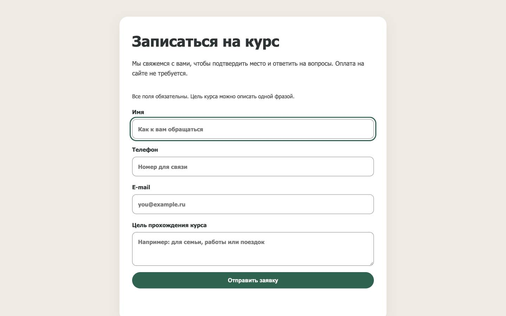
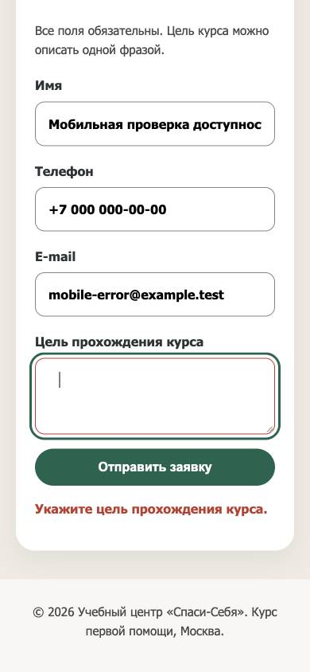

# Исправления доступности: результат

Дата: 2026-10-23. Проверена локальная версия, http://127.0.0.1:8765/.

Lighthouse Accessibility вырос с **96 до 100/100 на desktop и mobile**. В accessibility больше нет failed-пунктов. Это результат автоматической проверки и описанных ниже сценариев, не сертификат соответствия WCAG.

## Что внедрено

| Замечание исходного аудита | Исправление | Результат |
|---|---|---|
| CTA прокручивала без переноса фокуса | Все четыре кнопки переводят фокус в «Имя» | Проверено; следующий Tab ведёт в «Телефон» |
| После ответа формы фокус терялся на body | При успехе и общей ошибке фокус получает существующее сообщение с tabindex=-1; при известной ошибке - нужное поле | Проверены успех, четыре ошибки API и offline |
| Ошибка не была связана с полем | aria-invalid=true, aria-describedby с id сообщения, красная граница | Проверены name, phone, email, purpose |
| Старая ошибка после исправления | Снимаются ARIA-ошибка и старый текст, восстанавливается исходное описание | Проверено; у purpose сохраняется form-hint |
| Контраст подвала 4,02:1 | Цвет var(--text), #4a4a4a | Теперь **8,31:1**, требование 4,5:1 |
| Контраст границ полей 1,50:1 | Рамка #858585 на белом | Теперь **3,69:1**, требование 3:1 |
| JS всегда требовал плавную прокрутку | При prefers-reduced-motion используется instant | Ветка проверена с временной подменой matchMedia |

Форма получает aria-busy только на время запроса. Кнопка отправки снова доступна после каждого исхода. Если пользователь уже работает в другом контроле, ответ не перехватывает текущий фокус. Если значение ошибочного поля изменено во время ожидания, старый ответ не помечает новое значение ошибочным и не переводит фокус.

## Проверка ограничений

- STUDENTS.md разрешает оформление и не запрещает исправления клиентского управления фокусом. Старое «JS сохраняется» в site-constraints.md было рамкой первого прохода; перед изменениями это уточнено.
- HTML формы от открывающего до закрывающего тега **побайтно совпадает** с версией до accessibility-правок. Имена, типы, required, action, method, исходные поля и кнопка не изменены.
- Единственное изменение index.php в этом проходе - tabindex=-1 у существующего сообщения **вне формы**.
- Все .btn-register, .pricing-section, .program-list и шесть .program-module сохранены.
- api/ и SQL не менялись: git diff --exit-code HEAD -- api sql завершился с кодом 0.
- Согласованное ранее отсутствие подключения visit.php и даты 7-8 ноября 2026 сохранены.
- Новых зависимостей, изменений API, публикации кода, коммитов и деплоя нет.

## Пройденные сценарии

1. **Desktop-клавиатура:** Tab → «Оставить заявку» → Enter → фокус в «Имя»; следующий Tab → «Телефон». У фокуса видимый outline 3 px.
2. **Все тарифы:** каждая из трёх исходных кнопок прокручивает к регистрации и фокусирует «Имя».
3. **Ошибки полей:** реальные ответы локального PHP для пустых после trim имени/телефона/цели и email, принимаемого HTML-валидацией, но отклоняемого сервером. Ввод сохраняется; фокус, aria-invalid и aria-describedby соответствуют полю.
4. **Коррекция и повтор:** после ввода ошибка снимается; повторный submit не дублирует form-message в описании и сохраняет form-hint.
5. **Успех:** реальная заявка сохранена в локальной SQLite, форма очищена, фокус на сообщении успеха, busy снят, submit доступен. Найдена ровно одна запись для адреса синтетического теста.
6. **Сетевой сбой:** временный Offline в локальной вкладке; сообщение получает фокус, значения сохраняются, busy снимается и submit снова доступен. Сеть восстановлена; navigator.onLine=true.
7. **Ожидание ответа:** временно задерживалась передача реального ответа локального API. Переход в другое поле сохраняет фокус; исправление значения во время ожидания не получает устаревшую ARIA-ошибку. Временные fetch-обёртки удалены.
8. **Reduced motion:** временно подменён результат matchMedia и наблюдён параметр scrollIntoView при настоящем native scroll. Используется instant, фокус переводится в «Имя». Подмены восстановлены.
9. **Mobile 390x844:** клавиатурная отправка с ошибкой фокусирует purpose и связывает сообщение. Переполнения страницы нет.
10. **320 px:** document.scrollWidth=320, горизонтального переполнения нет.
11. **Статика:** node --check js/main.js, PHP lint index.php, git diff --check и проверка контрактов завершились успешно.
12. **Независимое read-only ревью:** существенных Critical/Important замечаний нет; последняя защита от устаревшей ошибки проверена отдельно. Ревью статическое, браузерные результаты получены выше.

## Скриншоты после правок

### Desktop: фокус в первом поле

### Mobile: ошибка связана с полем и фокус виден

## Изменённые исходники

- [js/main.js](/Users/abychkin/WebstormProjects/naition-low-conversion-landing/js/main.js) - фокус, reduced motion, ARIA-состояния, обработка исправления и устаревшего ответа.
- [css/style.css](/Users/abychkin/WebstormProjects/naition-low-conversion-landing/css/style.css) - контраст, видимый фокус сообщения и граница ошибочного поля.
- [index.php](/Users/abychkin/WebstormProjects/naition-low-conversion-landing/index.php) - tabindex=-1 у сообщения.

## Доказательства

- [Полные результаты сценариев](verification-after.json)
- [Lighthouse desktop](lighthouse-after-desktop.json)
- [Lighthouse mobile](lighthouse-after-mobile.json)
- [Контраст](contrast-after.json)
- [Исходный аудит до правок](report.md)
- [Gate ограничений](implementation.md)

## Границы

VoiceOver/NVDA, другие движки, реальные устройства, реальный browser zoom и фактическое переключение настройки reduced motion в ОС не проверялись. Ветка reduced motion проверена через временную подмену, а не реальную смену предпочтения ОС.

API не передаёт id ошибочного поля. Используются четыре текущих текста серверной валидации; если текст изменится или ошибка неизвестна, останется доступное общее сообщение. Это ограничение отмечено shortcut-комментарием в коде. Для прямой структурированной привязки потребуется разрешённое изменение серверного контракта в будущем.

Проверка фокуса ориентируется на текущий активный элемент и не хранит историю навигации. Успех формы сохраняет прежнее поведение reset. Данные синтетического успешного теста находятся только в игнорируемой локальной data/.

Симулятор и публичный сайт не развёртывались и не проверялись. Порядок публикации из STUDENTS.md остаётся прежним: ручная публикация, Redeploy с учётом сброса БД, затем симулятор и сравнение конверсии.
