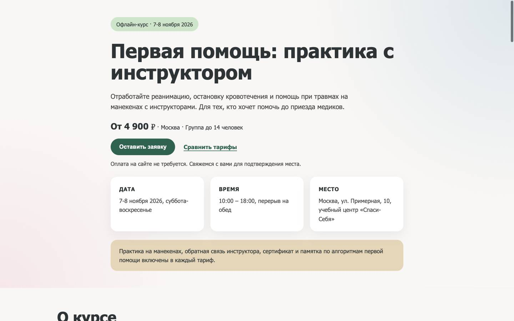
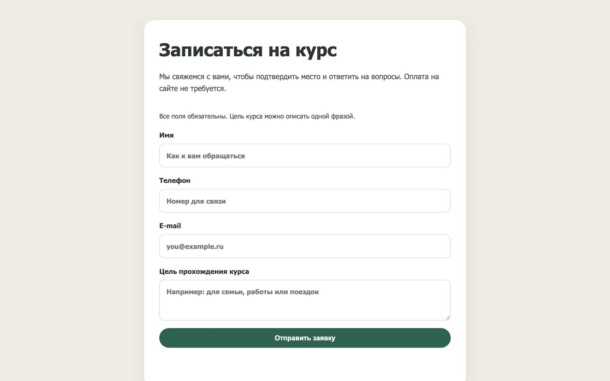
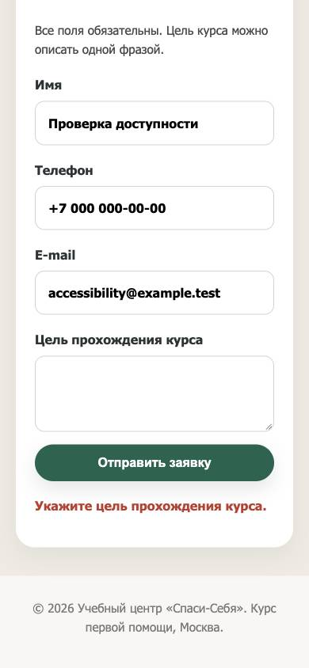
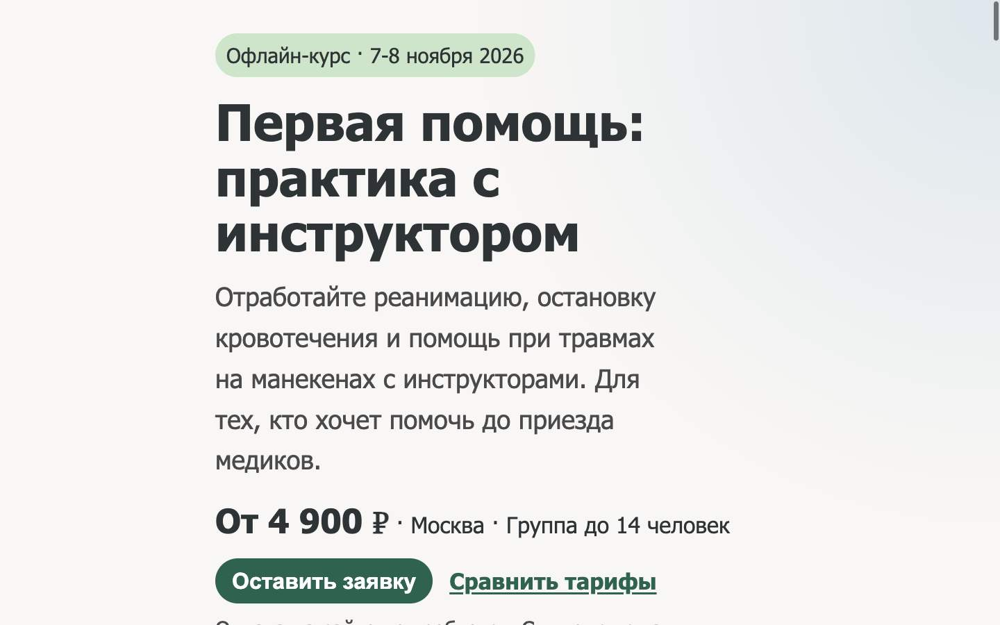

# Доступность лендинга

Это исходный аудит до исправлений. Согласованные правки внедрены; актуальные результаты и ограничения проверки - в [report-after.md](report-after.md).

Дата: 2026-10-23. Проверена **локальная рабочая версия** с датами 7-8 ноября 2026 и удалённым подключением visit.php: http://127.0.0.1:8765/. Публичный сайт с этими правками не развёртывался в рамках аудита.

## Общая оценка

Lighthouse Accessibility: **96/100 на desktop и mobile** в режиме snapshot. В категории accessibility не пройден один автоматический пункт - контраст текста подвала. Второй failed в общем выводе Lighthouse относится к другой категории и не считается второй ошибкой доступности.

Базовая семантика и подписи формы в порядке. Ручная проверка выявила проблемы фокуса, которые автоматическая оценка не отражает. Главный приоритет - исправить фокус при переходе к форме и после серверной ошибки.

Ориентир - WCAG 2.2 AA. Этот аудит не является подтверждением соответствия стандарту.

## Шаги и состояние

| Шаг | Сценарий | Состояние | Доказательство |
|---|---|---|---|
| 1 | Первый экран и начало навигации с клавиатуры | В целом хорошо: понятные controls, фокус виден | Скриншот 01, DOM и реальный Tab |
| 2 | Enter на «Оставить заявку» | Проблема: прокрутка к форме без переноса фокуса | Скриншот 02, активный элемент за пределами экрана |
| 3 | Серверная ошибка формы на mobile и с клавиатуры | Частично хорошо: текст ошибки и live-region; требуется восстановление фокуса и связь ошибки с полем | Скриншот 03, реальная локальная серверная валидация |
| 4 | Узкий экран и увеличение текста | В проверенном объёме хорошо: 320 px без горизонтального скролла, текст x2 без переполнения на desktop | Скриншот 04, измерения DOM |

### 1. Первый экран

Реальный Tab с начала документа фокусирует кнопку «Оставить заявку». Контур фокуса - 3 px, цвет #17634f. Контраст этого цвета с белым - 7,16:1. Кнопка около 181x47 px, ссылка «Сравнить тарифы» около 149x26 px: проверенные controls удовлетворяют минимальному размеру 24x24 CSS px по WCAG 2.5.8.

### 2. Переход к форме

После Enter форма оказывается у верхнего края viewport, но document.activeElement остаётся кнопкой «Оставить заявку» с координатой примерно -5314 px относительно viewport. Следующий Tab переводит фокус на «Сравнить тарифы» перед формой. Пользователь с клавиатурой теряет ожидаемое продолжение сценария.

**Приоритет 1. Перенести фокус в целевую область после активации CTA.** Подход: фокусировать заголовок формы с tabindex=-1 или первое поле. Исправлять в общем обработчике всех .btn-register.

Источник: [js/main.js:13](/Users/abychkin/WebstormProjects/naition-low-conversion-landing/js/main.js:13). Связанные критерии - WCAG 2.4.3 «Порядок фокуса» и 2.4.7 «Видимый фокус». Наблюдение подтверждено ручным сценарием; формальную оценку полного соответствия этих критериев не проводили.

### 3. Ошибка формы

Использованы синтетические данные и purpose из пробелов. Локальный сервер возвращает «Укажите цель прохождения курса.». Введённые значения сохраняются, сообщение помещается в aria-live=polite. Это положительные свойства. Отсутствие role=status само по себе не считается ошибкой: aria-live уже задаёт механизм объявления.

Реальный клавиатурный сценарий: заполнение полей, Tab на submit, Enter. После ответа активным элементом становится BODY. Поле purpose остаётся без aria-invalid, а aria-describedby указывает только на общий form-hint.

**Приоритет 1. После ошибочной отправки восстановить фокус.** Отключение активной кнопки при отправке и отсутствие последующего восстановления фокуса оставляют пользователя без явной точки продолжения. После ошибки следует сфокусировать проблемное поле или доступный блок ошибок; после успешной отправки отдельно продумать положение фокуса.

Источник: [js/main.js:27](/Users/abychkin/WebstormProjects/naition-low-conversion-landing/js/main.js:27), [js/main.js:54](/Users/abychkin/WebstormProjects/naition-low-conversion-landing/js/main.js:54). Связанные критерии - 2.4.3 и 2.4.7.

**Приоритет 2. Связать серверную ошибку с соответствующим полем.** Для известного ошибочного поля установить aria-invalid=true и добавить id сообщения в aria-describedby; сбрасывать состояние после исправления. Сейчас смысл ошибки понятен из текста, поэтому отсутствие этих атрибутов не объявляется самостоятельным доказанным провалом WCAG. Это улучшение восстановления после ошибки и работы со вспомогательными технологиями; ориентиры 3.3.1 и 4.1.2.

Источник: [index.php:305](/Users/abychkin/WebstormProjects/naition-low-conversion-landing/index.php:305), [index.php:309](/Users/abychkin/WebstormProjects/naition-low-conversion-landing/index.php:309). Реальное объявление screen reader не проверялось.

**Приоритет 2. Усилить контраст подвала.** Текст #7a7a7a на фоне #faf7f5 имеет контраст **4,02:1**, при размере 15,2 px и обычном начертании требуется **4,5:1**. Это подтверждено Lighthouse на обоих viewport и расчётом относительной яркости. Критерий WCAG 1.4.3 AA.

Источник: [css/style.css:422](/Users/abychkin/WebstormProjects/naition-low-conversion-landing/css/style.css:422). Достаточно затемнить текст до оттенка, проходящего 4,5:1 с фактическим фоном.

**Приоритет 2. Сделать границы полей заметнее.** Рамка #d8d2cb на белом даёт **1,50:1**. На скриншотах поля на белой карточке различаются главным образом этой слабой рамкой. Для границы, необходимой для распознавания компонента, ориентир WCAG 1.4.11 AA - **3:1**. Это вручную выявленный риск, а не дополнительная ошибка Lighthouse. Нужно усилить рамку или дать другой достаточно контрастный признак поля.

Источник: [css/style.css:394](/Users/abychkin/WebstormProjects/naition-low-conversion-landing/css/style.css:394).

### 4. Адаптивность и увеличение текста

На viewport 320x844 document.scrollWidth=320: горизонтального переполнения страницы нет. Проверены размеры полей и controls. Горизонтальная прокрутка длинного значения внутри однострочного input ожидаема и не считается переполнением страницы.

При desktop 1440x900 временно увеличен размер корневого шрифта с 16 до 32 px. Ширина страницы осталась 1440 px, поля сохранились, текст не обрезался на проверенном экране. Затем исходный размер восстановлен.

Это проверка масштабирования текста средствами DOM/CSS, **не реальный browser zoom**. Проверку 200%/400% масштабом браузера и полного сценария при таком масштабе отдельно не проводили. Ориентиры - 1.4.4 и 1.4.10.

## Подтверждённые сильные стороны

- lang=ru, один h1, один main, последовательная иерархия h1/h2/h3 без пропущенных уровней.
- У всех четырёх полей есть связанные label; required отражается в accessibility tree.
- У имени, телефона и email есть корректный autocomplete.
- У фото осмысленный alt: «Практика сердечно-легочной реанимации на манекене».
- Есть видимый focus-visible для links, buttons, inputs и textarea.
- Сообщение формы находится в заранее существующем aria-live=polite и содержит текстовое объяснение, а не только цвет.
- Проверенные размеры targets не меньше 24x24 CSS px; на 320 px нет переполнения страницы.

## Дополнительная рекомендация по движению

В CSS есть prefers-reduced-motion, отключающий плавную прокрутку через scroll-behavior. Однако JS явно задаёт behavior:'smooth' при каждой активации CTA. Эта ветка не учитывает пользовательское предпочтение уменьшенного движения.

Рекомендация: выбирать instant/auto при prefers-reduced-motion: reduce. Источники: [js/main.js:13](/Users/abychkin/WebstormProjects/naition-low-conversion-landing/js/main.js:13), [css/style.css:432](/Users/abychkin/WebstormProjects/naition-low-conversion-landing/css/style.css:432).

Это замечание по коду; реальная эмуляция reduced-motion не выполнялась. WCAG 2.3.3 относится к уровню AAA, поэтому это не объявляется отдельным доказанным нарушением целевого AA.

## Порядок исправлений

1. Общий обработчик CTA: прокрутка и перенос фокуса в форму.
2. Отправка формы: сохранение/восстановление фокуса, связь ошибки с полем.
3. Затемнить текст подвала и усилить границы полей.
4. Учесть reduced-motion в JS.
5. После правок повторить клавиатурные сценарии и проверить форму с VoiceOver или NVDA.

## Границы проверки

- Код сайта не изменялся. Сохранены только отчёт, результаты Lighthouse и скриншоты.
- Проверялась локальная рабочая версия, не доступность задеплоенного публичного сайта.
- Lighthouse выполнен в snapshot-режиме на desktop 1440x900 и mobile 390x844.
- Из вспомогательных технологий исследованы DOM и accessibility tree. VoiceOver/NVDA не запускались.
- Не проверены другие браузерные движки, реальные мобильные устройства, режим высокой контрастности и реальный масштаб браузера.
- Успешная отправка и её объявление screen reader в этом аудите не проверялись.
- Серверная ошибка воспроизводилась локально на синтетических значениях. Успешных заявок в рамках этого аудита не отправляли.
- Временное увеличение корневого шрифта отменено. API, маршрутизация и постоянные настройки браузера не менялись; viewport эмулировался для проверки.
- Оценка 96/100 не гарантирует полного соответствия WCAG.

## Артефакты

- [Результаты desktop](lighthouse-desktop.json)
- [Результаты mobile](lighthouse-mobile.json)
- [Ручные наблюдения и измерения](evidence.json)
- Четыре скриншота выше сняты в текущем аудите, сохранены и открыты для визуальной проверки.
